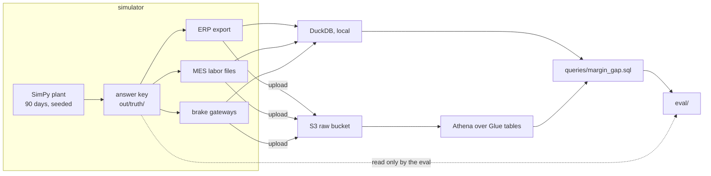
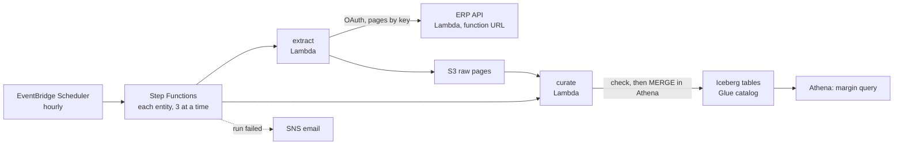

# Crestline Supply

[](https://github.com/trcollinson/crestline-supply/actions/workflows/ci.yml)

A simulated mid-market metal fabrication plant, the messy data its systems produce, and an AWS data platform that joins them.

Mid-market manufacturers have three data sources that never meet. The ERP knows the money, but costs every job at standard. The MES knows what people scanned and typed. The machines know what actually happened, but not which job it was. The value lives in the join, and so does the difficulty.

Crestline Supply is a fictional plant built to work on that join honestly. A simulator records what really happened on the floor, then writes what the ERP, the MES, and the machine gateways would each have recorded: three partial, distorted views of the same truth. Queries run over those views and never see the truth. An eval scores them against it.

## The first question: is the ERP right about margin?

Press brake PB-02's setups on second shift take almost three times standard. The ERP applies machine burden at standard hours, so it never notices. Rebuilding each job's cost from MES scans and brake stroke counters does.

| Brake, setup shift | ERP margin | Rebuilt | True |
|---|---|---|---|
| PB-01, 1st | 24.3% | 25.5% | 27.1% |
| PB-01, 2nd | 25.9% | 27.8% | 28.6% |
| PB-02, 1st | 23.2% | 23.9% | 25.0% |
| **PB-02, 2nd** | **20.5%** | **14.8%** | **16.0%** |

Rebuilt job cost lands within 1% of the true cost for 90% of jobs. The ERP's own "actual" cost manages that for 15%.

## The second question: is your copy of the ERP right?

Every number above is only as good as the copy of the ERP it runs on. The simulated ERP now serves its history through an API that changes while you read it, with nine messes a mid-market ERP integrator would recognize: expiring tokens, throttling, random 500s, paging that drifts, numbers as strings, legacy dates, a `LastModified` that doesn't move when labor posts, duplicate orders cancelled the next morning, and jobs split after release.

The extractor most people write first (sign in once, ask for what changed since the newest stamp, follow `nextLink`) never throws an error. Run nightly for 90 days and scored against the ERP's final state:

| Scenario | Naive extractor, rows wrong of 18,707 | Robust extractor |
|---|---|---|
| Clean ERP (control) | 0 | 0 |
| Realistic ERP | 5,762 (30.8%), plus 55 deleted rows kept | 0 |
| Client polling hard (10 requests a second) | 5,991 (32.0%), plus 51 deleted rows kept | 0 |
| Slow ERP (5 minutes a page) | 5,813 (31.1%), plus 55 deleted rows kept | 0 |
| Slow ERP (15 minutes a page) | 17,457 (93.3%) | 0 |

The robust one signs in again on a 401, waits out 429s, backs off on 5xx, pages by key, reads labor by sequence number, and sweeps the job tables every night, because no incremental read can see a change that doesn't move the timestamp. On AWS it runs hourly, lands every page in S3 untouched, and merges them into Iceberg tables that match the ERP exactly; the margin query above runs on them unchanged.

## How it fits together



The ERP extraction on AWS:



## Run it locally

Needs Python 3.12 and [uv](https://docs.astral.sh/uv/). Run from the repo root.

```sh
uv sync
uv run crestline sim backfill --days 90 --end 2026-10-01 --seed 42
uv run crestline query margin-gap
uv run python eval/margin_gap.py
uv run python eval/extraction.py
```

The backfill takes a few seconds and writes everything to `out/`: the answer key in `out/truth/`, and the ERP store and export, MES files, and brake messages beside it. Same seed, same bytes, every time. `eval/extraction.py` runs both ERP extractors every night of the window against the API in process, on a clock it controls, so 90 nights take seconds; `--erp-seconds-per-request 900` slows the ERP to 15 minutes a page.

To see where the naive extractor's 30.8% comes from, give the ERP honest timestamps: add these lines to `mess.yaml`, then run the backfill and `eval/extraction.py --extractor naive` again. Its stale rows go to zero; the 55 deleted rows it kept stay, because only a full read can notice a delete.

```yaml
erp:
  lastmodified_skips: []
```

The ERP API also runs on its own, with its messes, replaying its history an hour a second:

```sh
uv run python -m crestline_erp_api --mess mess.yaml --clock-start 2026-07-03T06:00:00Z --clock-speed 3600
```

It listens on port 8100; the client ID is `crestline-local` and the secret `local-secret`.

To watch the story switch off, set `enabled: false` under `pb02_second_shift_setups` in `scenarios.yaml` and run the backfill and the query again. PB-02 second shift falls in line with the other groups.

## Run it on AWS

Everything deploys into your own account and runs serverless. You need Node.js with the CDK CLI (`npm install -g aws-cdk`, 2.1143 or later), the AWS CLI, and an AWS profile with a region configured. Run from the repo root, after the local backfill above.

```sh
export AWS_PROFILE=<profile>
(cd infra && cdk bootstrap && cdk deploy CrestlineFoundation)
uv run crestline sim backfill --days 90 --end 2026-10-01 --seed 42 --upload
uv run crestline erp-api secrets
(cd infra && cdk deploy CrestlineErpApi -c erpApiMess=../mess.yaml -c erpApiClockStart=2026-08-03T05:00:00Z -c erpApiClockSpeed=24)
(cd infra && cdk deploy CrestlineCurated)
(cd infra && cdk deploy CrestlineErpIngest -c erpIngestAlarmEmail=<you@example.com>)
```

`cdk bootstrap` is needed once per account and region, and each deploy asks once to approve the IAM roles it creates.

- **CrestlineFoundation**: the raw and query-result buckets, a Glue database, and an Athena workgroup capped at 1 GB per query. The backfill's `--upload` puts the ERP export, MES files, and brake messages in the raw bucket.
- **CrestlineErpApi**: the ERP API in a Lambda function behind a function URL, with its messes, replaying the ERP's history from Aug 3 at 24 times real time: an ERP day every hour. Its clock stops at the end of the history, Oct 1. `crestline erp-api secrets` puts its client secret and signing key in Parameter Store first.
- **CrestlineCurated**: the Iceberg tables, one per ERP entity.
- **CrestlineErpIngest**: the poller. Its first run starts as soon as the stack exists, then hourly. Each entity is extracted to S3, then checked and merged into its Iceberg table. `erpIngestAlarmEmail` is optional: it subscribes an address to failed-run alarms (confirm the email SNS sends).

About two and a half days later, the replay reaches the end of the history and the poller has read it all. Then point Athena's views at the curated tables, score them against the ERP, and run the margin query on them:

```sh
uv run crestline athena setup
uv run python eval/curated.py --margin
uv run crestline query margin-gap --engine athena
```

`eval/curated.py` compares every curated table with the ERP's final state row for row, and the margin query in Athena with DuckDB's over the export, cell for cell.

Idle, all of it costs next to nothing. While the poller runs hourly, it's about $1 a month, nearly all Athena's 10 MB minimum per query: each run checks and merges eleven tables.

To take it down, destroy the poller first; it holds the schedule, so polling stops as soon as it's gone. Then the rest, and the two secrets:

```sh
cd infra
cdk destroy CrestlineErpIngest
cdk destroy CrestlineErpApi CrestlineCurated CrestlineFoundation
cd ..
uv run crestline erp-api secrets --delete
```

The buckets are emptied for you. That leaves the log groups of the Lambda functions that emptied them:

```sh
aws logs describe-log-groups --log-group-name-prefix /aws/lambda/CrestlineFoundation --query 'logGroups[].logGroupName'
aws logs describe-log-groups --log-group-name-prefix /aws/lambda/CrestlineCurated --query 'logGroups[].logGroupName'
aws logs delete-log-group --log-group-name <name from above>
```

## Layout

| | |
|---|---|
| `src/crestline/sim/` | the SimPy plant, the hidden scenario, and the ERP, MES, and brake gateway writers |
| `interfaces/erp-api/` | the ERP's REST API and its messes |
| `pipelines/erp_extract/` | the naive and robust extractors, the raw page format, and the curate step's SQL |
| `reference/` | parts, routings, rates, customers, employees, all fictional |
| `queries/` | the SQL, one file for both engines; `athena/` holds the raw tables and views |
| `infra/` | the CDK app: one stack per layer |
| `eval/` | scoring against the answer key, and the extractors and curated tables against the ERP |
| `docs/SPEC.md` | the design: the plant, its systems, the messes, and the milestones |

One rule holds it together: the query, the API, the extractors, and the AWS code never read `out/truth/` or import the simulator. Only the eval and the tests may. A test enforces it.

## Status

Milestone 2 of 7: the ERP API with its messes, a naive and a robust extractor, the scheduled poller, and curated Iceberg tables, on top of milestone 1's plant, margin query, and AWS foundation. Next come the machines: MQTT from a modern laser, a mid-age brake, and a legacy counter, into AWS IoT Core. The roadmap is in `docs/SPEC.md`.

## License

Apache 2.0. Copyright 2026 Tim Collinson.
