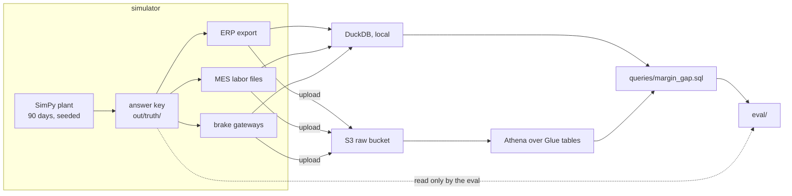

# Crestline Supply

[](https://github.com/trcollinson/crestline-supply/actions/workflows/ci.yml)

A simulated mid-market metal fabrication plant, the messy data its systems produce, and an AWS data platform that joins them.

Mid-market manufacturers have three data sources that never meet. The ERP knows the money, but costs every job at standard. The MES knows what people scanned and typed. The machines know what actually happened, but not which job it was. The value lives in the join, and so does the difficulty.

Crestline Supply is a fictional plant built to work on that join honestly. A simulator records what really happened on the floor, then writes what the ERP, the MES, and the machine gateways would each have recorded: three partial, distorted views of the same truth. Queries run over those views and never see the truth. An eval scores them against it.

## The first question: is the ERP right about margin?

Press brake PB-02's setups on second shift take almost three times standard. The ERP applies machine burden at standard hours, so it never notices. Rebuilding each job's cost from MES scans and brake stroke counters does.

| Brake, setup shift | ERP margin | Rebuilt | True |
|---|---|---|---|
| PB-01, 1st | 24.3% | 25.5% | 27.1% |
| PB-01, 2nd | 25.9% | 27.8% | 28.6% |
| PB-02, 1st | 23.0% | 23.7% | 25.0% |
| **PB-02, 2nd** | **20.4%** | **14.8%** | **16.0%** |

Rebuilt job cost lands within 1% of the true cost for 92% of jobs. The ERP's own "actual" cost manages that for 15%.

## How it fits together



## Run it locally

Needs Python 3.12 and [uv](https://docs.astral.sh/uv/). Run from the repo root.

```sh
uv sync
uv run crestline sim backfill --days 90 --end 2026-10-01 --seed 42
uv run crestline query margin-gap
uv run python eval/margin_gap.py
```

The backfill takes a few seconds and writes everything to `out/`: the answer key in `out/truth/`, and the ERP export, MES files, and brake messages beside it. Same seed, same bytes, every time.

## Run it on AWS

The same query runs in Athena over the same files in S3. You need an AWS profile, Node.js, and the CDK CLI (2.1143 or later). If the account isn't bootstrapped for CDK yet, run `uv run cdk bootstrap` in `infra/` once.

```sh
export AWS_PROFILE=<profile> AWS_REGION=<region>
(cd infra && uv run cdk deploy)
uv run crestline sim backfill --days 90 --end 2026-10-01 --seed 42 --upload
uv run crestline athena setup
uv run crestline query margin-gap --engine athena
```

The stack is two S3 buckets, a Glue database, and an Athena workgroup capped at 1 GB per query. Idle, it costs next to nothing; the margin query scans about 100 MB, a twentieth of a cent. `cdk destroy` in `infra/` removes everything except the log group of the Lambda that empties the buckets.

## Layout

| | |
|---|---|
| `src/crestline/sim/` | the SimPy plant, the hidden scenario, and the ERP, MES, and brake gateway writers |
| `reference/` | parts, routings, rates, customers, employees, all fictional |
| `queries/` | the SQL, one file for both engines; `athena/` holds the raw tables and views |
| `infra/` | the CDK app |
| `eval/` | scoring against the answer key |
| `docs/SPEC.md` | the design: the plant, its systems, the messes, and the milestones |

One rule holds it together: the query, upload, and Athena code never reads `out/truth/` or imports the simulator. Only the eval and the tests may. A test enforces it.

## Status

Milestone 1 of 7: the plant, one hidden scenario, four messes, the margin query, and the AWS foundation. Next comes the full ERP API with its messes and an ingestion poller. The roadmap is in `docs/SPEC.md`.

## License

Apache 2.0. Copyright 2026 Tim Collinson.
