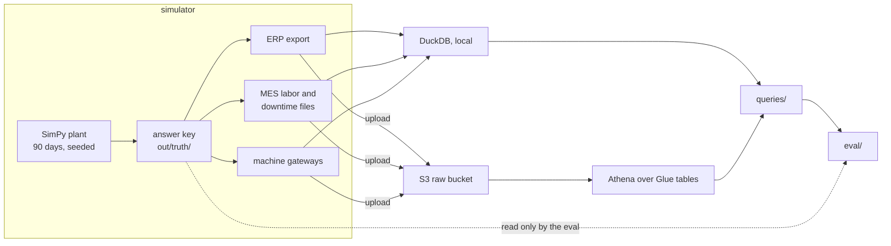
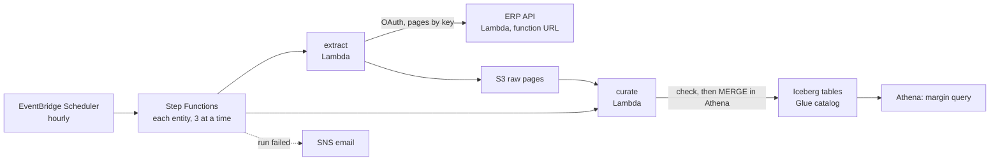
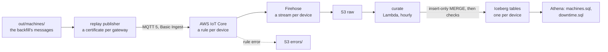

# Crestline Supply

[](https://github.com/trcollinson/crestline-supply/actions/workflows/ci.yml)

A simulated mid-market metal fabrication plant, the messy data its systems produce, and an AWS data platform that joins them.

Mid-market manufacturers have three data sources that never meet. The ERP knows the money, but costs every job at standard. The MES knows what people scanned and typed. The machines know what actually happened, but not which job it was. The value lives in the join, and so does the difficulty.

Crestline Supply is a fictional plant built to work on that join honestly. A simulator records what really happened on the floor, then writes what the ERP, the MES, and the machine gateways would each have recorded: three partial, distorted views of the same truth. Queries run over those views and never see the truth. An eval scores them against it.

## The first question: is the ERP right about margin?

Press brake PB-02's setups on second shift take almost three times standard. The ERP applies machine burden at standard hours, so it never notices. Rebuilding each job's cost from MES scans and brake stroke counters does.

| Brake, setup shift | ERP margin | Rebuilt | True |
|---|---|---|---|
| PB-01, 1st | 24.3% | 25.5% | 27.1% |
| PB-01, 2nd | 25.9% | 27.8% | 28.6% |
| PB-02, 1st | 23.2% | 23.9% | 25.0% |
| **PB-02, 2nd** | **20.5%** | **14.8%** | **16.0%** |

Rebuilt job cost lands within 1% of the true cost for 90% of jobs. The ERP's own "actual" cost manages that for 15%.

## The second question: is your copy of the ERP right?

Every number above is only as good as the copy of the ERP it runs on. The simulated ERP now serves its history through an API that changes while you read it, with nine messes a mid-market ERP integrator would recognize: expiring tokens, throttling, random 500s, paging that drifts, numbers as strings, legacy dates, a `LastModified` that doesn't move when labor posts, duplicate orders cancelled the next morning, and jobs split after release.

The extractor most people write first (sign in once, ask for what changed since the newest stamp, follow `nextLink`) never throws an error. Run nightly for 90 days and scored against the ERP's final state:

| Scenario | Naive extractor, rows wrong of 18,707 | Robust extractor |
|---|---|---|
| Clean ERP (control) | 0 | 0 |
| Realistic ERP | 5,762 (30.8%), plus 55 deleted rows kept | 0 |
| Client polling hard (10 requests a second) | 5,991 (32.0%), plus 51 deleted rows kept | 0 |
| Slow ERP (5 minutes a page) | 5,813 (31.1%), plus 55 deleted rows kept | 0 |
| Slow ERP (15 minutes a page) | 17,457 (93.3%) | 0 |

The robust one signs in again on a 401, waits out 429s, backs off on 5xx, pages by key, reads labor by sequence number, and sweeps the job tables every night, because no incremental read can see a change that doesn't move the timestamp. A sweep deletes whatever it didn't see, so it has to prove it saw everything: it counts the ERP's rows when it starts and when it ends, and one that comes up short is filed as short and deletes nothing. On AWS it runs hourly, lands every page in S3 untouched, and merges them into Iceberg tables that match the ERP exactly; the margin query above runs on them unchanged.

## The third question: what did the machines really do?

The margin above leans on stroke counters, so they had better be right. Crestline's machines span four generations, and each reports its own way: the fiber laser speaks Sparkplug B over MQTT (protobuf, metric aliases, births and deaths), press brake PB-01 sends flat JSON through an edge gateway, PB-02 and the hardware press PEM-01 are 16-bit counters polled every 30 seconds, and the powder coat line streams oven temperatures and a hook count every 5 seconds. Their gateways do what gateways do. Device clocks drift (PB-01's by minutes). QoS 1 delivers some messages twice. The network drops, and buffered messages come back late, one gateway newest first. A message is cut short in transit. The legacy counters roll over at 65,535 and go back to zero when someone power-cycles the machine.

There's no historian. `queries/machines.sql` rebuilds the record one would have kept: it drops the duplicates, puts each message at the moment it really happened (it trusts the fastest message each hour, the trick NTP uses), and tells a rollover from a reset by whether the strokes could fit in the time that passed. Scored against the answer key over 90 days:

| Cycles per machine per day | Within 2% of the truth |
|---|---|
| Counter differences, read straight off the messages | 95.9% of 320 machine-days: 13 power cycles read as rollovers, 65,000-stroke days |
| Rebuilt | 100% of 320 |

Downtime is harder. The MES has a downtime file, filled in the way operators fill one in: short stops never, longer ones when someone has time. `queries/downtime.sql` finds stops in what the machines say (the laser in alarm, PB-01 faulted, the coating line's conveyor stopped) and in gaps between strokes.

| Of 749 true stops, found by | All | Over 5 minutes |
|---|---|---|
| The MES downtime file | 30.8% | 71.6% |
| Rebuilt from machine data | 70.0% | 85.5% |
| Both, overlaps merged | 75.2% | 97.5% |

Together they cover 95.5% of the true downtime hours, and 99% of the stops either one reports are real. Each sees what the other can't: the laser shows a nozzle change as setup and maintenance as idle, and a gap under 3 minutes looks like a slow cycle, but nobody writes down a 4-minute jam. The margin table at the top comes out the same, cell for cell, when its strokes come from the rebuilt data.

On AWS the same 90 days of machine messages go through AWS IoT Core, each gateway with its own certificate: 2,216,620 messages, every one accounted for in S3, in an error prefix, or in IoT Core's count of messages it couldn't parse. Curated into Iceberg tables, every result above comes out of Athena exactly as it comes out of DuckDB.

What it costs depends on what the gateway sends. A one-hour load test of 1,000 tags changing once a second, read from the bill:

| 1,000 tags at 1 Hz | A message per tag change | One batch a second |
|---|---|---|
| Per hour | $1.58 | under $0.01 |
| Per month | about $1,150 | about $2 to $4 |

IoT Core bills per message through its rules, and Amazon Data Firehose bills each record as at least 5 KB, so the 78-byte records billed at 62 times their size. Batch at the edge.

## How it fits together



The ERP extraction on AWS:



The machines on AWS:



## Run it locally

Needs Python 3.12 and [uv](https://docs.astral.sh/uv/). Run from the repo root.

```sh
uv sync
uv run crestline sim backfill --days 90 --end 2026-10-01 --seed 42
uv run crestline query margin-gap
uv run crestline query downtime
uv run python eval/margin_gap.py
uv run python eval/extraction.py
uv run python eval/machines.py
```

The backfill writes everything to `out/`: the answer key in `out/truth/`, and beside it the ERP store and export, the MES files, and each machine's messages as they left its gateway (`out/machines/`, the laser's as base64 protobuf). Same seed, same bytes, every time. `eval/machines.py` prints the cycle and downtime tables above, by machine and generation, and gives every miss a reason. `uv run python eval/mess_rates.py` counts how often each mess really happened, month by month, against its setting in `mess.yaml`. `eval/extraction.py` runs both ERP extractors every night of the window against the API in process, on a clock it controls, so 90 nights take seconds; `--erp-seconds-per-request 900` slows the ERP to 15 minutes a page.

To see where the naive extractor's 30.8% comes from, give the ERP honest timestamps: add these lines to `mess.yaml`, then run the backfill and `eval/extraction.py --extractor naive` again. Its stale rows go to zero; the 55 deleted rows it kept stay, because only a full read can notice a delete.

```yaml
erp:
  lastmodified_skips: []
```

The ERP API also runs on its own, with its messes, replaying its history an hour a second:

```sh
uv run python -m crestline_erp_api --mess mess.yaml --clock-start 2026-07-03T06:00:00Z --clock-speed 3600
```

It listens on port 8100; the client ID is `crestline-local` and the secret `local-secret`.

To watch the story switch off, set `enabled: false` under `pb02_second_shift_setups` in `scenarios.yaml` and run the backfill and the query again. PB-02 second shift falls in line with the other groups.

## Run it on AWS

Everything deploys into your own account and runs serverless. You need Node.js with the CDK CLI (`npm install -g aws-cdk`, 2.1143 or later), the AWS CLI, and an AWS profile with a region configured. Run from the repo root, after the local backfill above.

```sh
export AWS_PROFILE=<profile>
(cd infra && cdk bootstrap && cdk deploy CrestlineFoundation)
uv run crestline sim backfill --days 90 --end 2026-10-01 --seed 42 --upload
uv run crestline erp-api secrets
(cd infra && cdk deploy CrestlineErpApi -c erpApiMess=../mess.yaml -c erpApiClockStart=2026-08-03T05:00:00Z -c erpApiClockSpeed=24)
(cd infra && cdk deploy CrestlineCurated)
(cd infra && cdk deploy CrestlineErpIngest -c erpIngestAlarmEmail=<you@example.com>)
(cd infra && cdk deploy CrestlineMachineIngest -c machineIngestAlarmEmail=<you@example.com>)
uv run crestline machines setup
uv run crestline athena setup
```

`cdk bootstrap` is needed once per account and region, and each deploy asks once to approve the IAM roles it creates.

- **CrestlineFoundation**: the raw and query-result buckets, a Glue database, and an Athena workgroup capped at 1 GB per query. The backfill's `--upload` puts the ERP export, MES files, and brake messages in the raw bucket.
- **CrestlineErpApi**: the ERP API in a Lambda function behind a function URL, with its messes, replaying the ERP's history from Aug 3 at 24 times real time: an ERP day every hour. Its clock stops at the end of the history, Oct 1. `crestline erp-api secrets` puts its client secret and signing key in Parameter Store first. To skip the replay, deploy it without the clock (`cdk deploy CrestlineErpApi -c erpApiMess=../mess.yaml`): it serves the ERP as it stands at the end of its history, and the poller's first run reads all of it.
- **CrestlineCurated**: the Iceberg tables, one per ERP entity.
- **CrestlineErpIngest**: the poller. Its first run starts as soon as the stack exists, then hourly. Each entity is extracted to S3, then checked and merged into its Iceberg table. Every merge that can delete writes down exactly which keys it deleted, from the table's Iceberg snapshot before the merge, to `audit/merges/` in the curated bucket. A merge that would delete more than 5% of a table is refused, and the alarm address gets the count and a file of the keys. `erpIngestAlarmEmail` is optional: it subscribes an address to failed-run alarms (confirm the email SNS sends).
- **CrestlineMachineIngest**: an IoT thing and policy per gateway, a rule and a Firehose stream per device into the raw bucket, and the curator: an hourly Lambda that merges new messages into one Iceberg table per device (insert only; a table that ever shrinks fails the run and emails the alarm address) and then checks the data's shape: null rates against each table's last 7 runs, unique keys, and each day's brake strokes against the pieces the MES scanned at the brakes. The ERP poller runs the same kind of checks after every run. CloudFormation can't hand out a private key, so `crestline machines setup` makes a certificate for each gateway and keeps the keys in `.secrets/machines/` (gitignored), and puts the Sparkplug schema where the laser's rule can decode it.
- `crestline athena setup` creates the Athena tables and views every query reads: the backfill's raw files, views with the same names over the curated tables, and the clean machine data on top of them (`queries/machines.sql`). Run it before the machine curator's first hourly run: its brake check reads those views.

Then replay the backfill's 90 days of machine messages through IoT Core, and check that every message arrived:

```sh
uv run crestline machines publish --from 2026-07-03 --to 2026-09-30 --speed 2000
uv run crestline machines account
```

At 2,000 times real time the replay takes about an hour and a half. IoT Core accepts 100 messages a second per connection, so the publisher opens as many connections per gateway as the speed needs. `machines account` checks, per device, that every message sent is in the raw bucket, in the rules' error prefix, or in the rule's parse-error count (a JSON message IoT Core can't parse reaches neither S3 prefix), and that IoT Core acknowledged every one. If a gateway's connection drops, the publisher reconnects and sends again what was in flight; MQTT's QoS 1 delivers at least once, so a message can land twice. `machines account` counts those copies as redelivered rather than as messages. The curator merges the replay at its next hourly run.

About two and a half days later (or after the first hourly run, without the clock), the poller has read the ERP's whole history, and the curator has merged the replay. Then score the curated tables against the ERP, and run the margin query on them:

```sh
uv run python eval/curated.py --margin
uv run crestline query margin-gap --engine athena
uv run pytest -m athena
```

`eval/curated.py` compares every curated table with the ERP's final state row for row, and the margin query in Athena with DuckDB's over the export, cell for cell. `pytest -m athena` runs the tests that need the real engine: Athena against DuckDB on the machine data, cell for cell, the margin table included; plant-local timestamps through the views and back as exact UTC instants, daylight saving included; and each data-shape check passing on the real tables and tripping on a fault planted in a copy.

To see the delete guard work, plant a broken sweep: `eval/fire_drill.py` copies the newest `Jobs` sweep in the raw bucket, keeps only its first page, and files it as a complete read, as if a bug had fooled the extractor's check. Then merge:

```sh
uv run python eval/fire_drill.py
uv run crestline curate Jobs
uv run python eval/fire_drill.py --remove
```

`crestline curate` refuses: the merge would delete every job after page 1. Nothing in the table changes, the alarm address gets an email naming the count, the table's snapshot, and the read, and `audit/merges/entity=Jobs/` gets a `-refused.json` file listing every key it would have deleted. The poller's next run doesn't trip on it: its own sweep is newer and complete, so the merge starts there.

Idle, all of it costs next to nothing. While the poller and the machine curator run hourly, it's about $2 a month, nearly all Athena's 10 MB minimum per query: each run checks and merges its tables. The 90-day machine replay costs about $1 once (IoT Core's rules and actions, and Firehose's 5 KB minimum on 2.2 million small records).

To take it down, delete the gateways' certificates first: `cdk destroy` can't remove a thing or a policy a certificate is still attached to. Then destroy the poller and the machine stack, which hold the hourly schedules, so nothing runs while the rest goes. Then the rest, and the two secrets:

```sh
uv run crestline machines setup --delete
cd infra
cdk destroy CrestlineErpIngest CrestlineMachineIngest
cdk destroy CrestlineErpApi CrestlineCurated CrestlineFoundation
cd ..
uv run crestline erp-api secrets --delete
```

The buckets are emptied for you. That leaves the log groups of the Lambda functions that emptied them:

```sh
aws logs describe-log-groups --log-group-name-prefix /aws/lambda/CrestlineFoundation --query 'logGroups[].logGroupName'
aws logs describe-log-groups --log-group-name-prefix /aws/lambda/CrestlineCurated --query 'logGroups[].logGroupName'
aws logs delete-log-group --log-group-name <name from above>
```

## Layout

| | |
|---|---|
| `src/crestline/sim/` | the SimPy plant, the hidden scenario, and the ERP, MES, and machine gateway writers |
| `interfaces/erp-api/` | the ERP's REST API and its messes |
| `interfaces/machines/` | the Sparkplug B schema, the device list, the replay publisher, and the load test generator |
| `pipelines/erp_extract/` | the naive and robust extractors, the raw page format, and the curate step's SQL |
| `pipelines/machine_curate/`, `pipelines/checks/` | the machine curator, and the data-shape checks both pipelines run |
| `reference/` | parts, routings, rates, customers, employees, all fictional |
| `queries/` | the SQL, one file for both engines; `athena/` holds the raw tables and views |
| `infra/` | the CDK app: one stack per layer |
| `eval/` | scoring against the answer key, and the extractors and curated tables against the ERP |
| `docs/SPEC.md` | the design: the plant, its systems, the messes, and the milestones |

One rule holds it together: the queries, the API, the publisher, the pipelines, and the AWS code never read `out/truth/` or import the simulator. Only the eval and the tests may. A test enforces it.

## Status

Milestone 3 of 8: four generations of machine data with their gateways' messes, rebuilt into cycles and downtime, through AWS IoT Core into curated Iceberg tables, on top of milestone 2's ERP extraction and milestone 1's plant and margin query. Next: an agent with read-only access to the curated data, and a test that instructions planted in MES notes stop at the policy layer. The roadmap is in `docs/SPEC.md`.

## License

Apache 2.0. Copyright 2026 Tim Collinson. `interfaces/machines/proto/sparkplug_b.proto` is Eclipse Tahu's, unmodified, under the Eclipse Public License 2.0 (its header says so).
